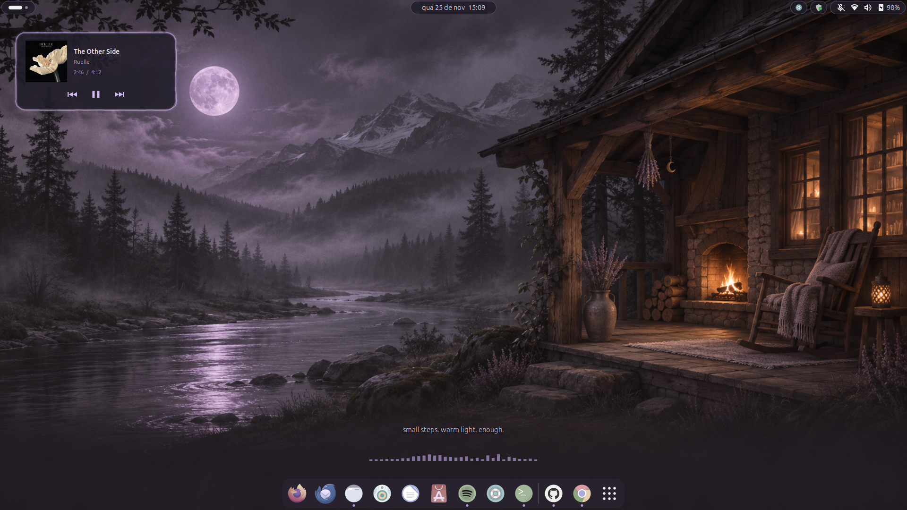
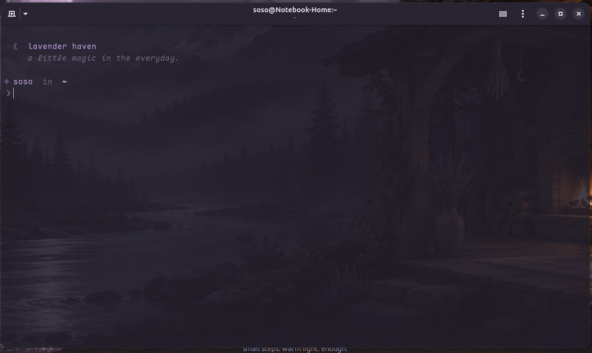
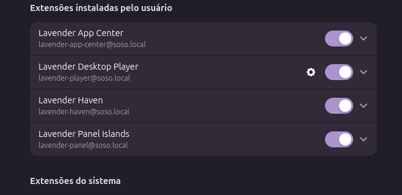

# Lavender Haven desktop backup

A snapshot of a customized Ubuntu GNOME desktop, with scripts to refresh the snapshot and restore it on another machine. It was captured on Ubuntu 26.04.1 LTS with GNOME Shell 50.

## Screenshots

A look at the Lavender Haven desktop, dock, panel and desktop player:



The themed terminal and Bash prompt:



The four custom extensions installed and enabled:



## What's included

- GNOME appearance, Shell, dock and extension settings, including enabled extensions and pinned applications.
- The Lavender Haven GTK theme, icon sets, cursor themes and wallpaper.
- Four custom GNOME extensions, including their source code and resources: Lavender App Center, Lavender Desktop Player, Lavender Haven and Lavender Panel Islands. Find them in [`snapshot/home/.local/share/gnome-shell/extensions`](snapshot/home/.local/share/gnome-shell/extensions).
- Ptyxis terminal settings and Lavender Haven palette, plus the locally installed Maple Mono font.
- Bash startup files, the Lavender Haven prompt script and locally installed Spicetify files referenced by the Bash configuration.
- A package inventory and extension list for reference in [`snapshot`](snapshot).

The snapshot contains the files themselves, including custom extensions; downloading them from the GNOME Extensions site is not necessary. It is a desktop configuration backup, not a complete backup of applications, documents, browser profiles, accounts or credentials.

## Restore on another machine

Use a compatible Ubuntu GNOME installation, ideally the same release and GNOME Shell version. Copy or clone the entire repository, preserving symbolic links and executable permissions. Log into the graphical desktop, open a terminal in the repository directory and run:

```bash
./restore.sh --install-packages
./restore.sh
```

The first command uses `sudo` and Ubuntu's package repositories to install the main dependencies. It requires network access. If a package is unavailable on your release, install the appropriate equivalents manually before running the second command. The restore script also requires Python 3 and an active graphical session with D-Bus.

The restore merges the captured files and dconf settings into your account and adjusts references to the original home directory. It saves copies of affected existing files and exports of previous settings in a timestamped `~/desk-restore-previous-*` directory. Existing files and settings outside the snapshot remain in place. Log out and back in afterward to reload GNOME Shell and the extensions.

Check your dock and Extensions app after logging back in. Pinned applications must be installed separately, and the custom extensions may require changes for a different GNOME Shell version. Binaries such as Spicetify may need to be reinstalled for a different processor architecture. Other machine-specific paths or dependencies may also need adjustment. The restore has not been tested on a second machine.

## Refresh the snapshot

On the source machine, in a graphical GNOME session, run:

```bash
./backup.sh
```

This replaces the `snapshot` directory in the repository with the current captured configuration. It does not change a separate copy of this backup. Review the resulting Git changes before committing. The script needs `dconf` and Python 3, plus enough free disk space for a temporary copy.

The original backup remains at `~/Documentos/desk-backup`; refreshing this repository does not update that separate folder.

## Repository layout

```text
backup.sh                   Capture a new snapshot of the current account
restore.sh                  Restore the saved files and desktop settings
snapshot/home/              Saved home-directory files and assets
snapshot/dconf/             GNOME and terminal settings exports
snapshot/extension-list.txt  Captured extensions and enabled state
snapshot/installed-packages.tsv  Package inventory for reference
snapshot/source-home        Original home path used for relocation
snapshot/paths.nul          List of captured paths used by restore.sh
```

The `.local` and `.config` directories inside `snapshot/home` are hidden in graphical file managers. Press **Ctrl+H** to show hidden files.

## Before sharing

Review the snapshot before publishing or sharing it: shell files, desktop settings, installed-package lists, paths and custom assets can contain personal information. This repository also contains third-party themes, fonts and binaries; check their licenses before redistributing them. Git must preserve the symbolic links used by the icon themes.
